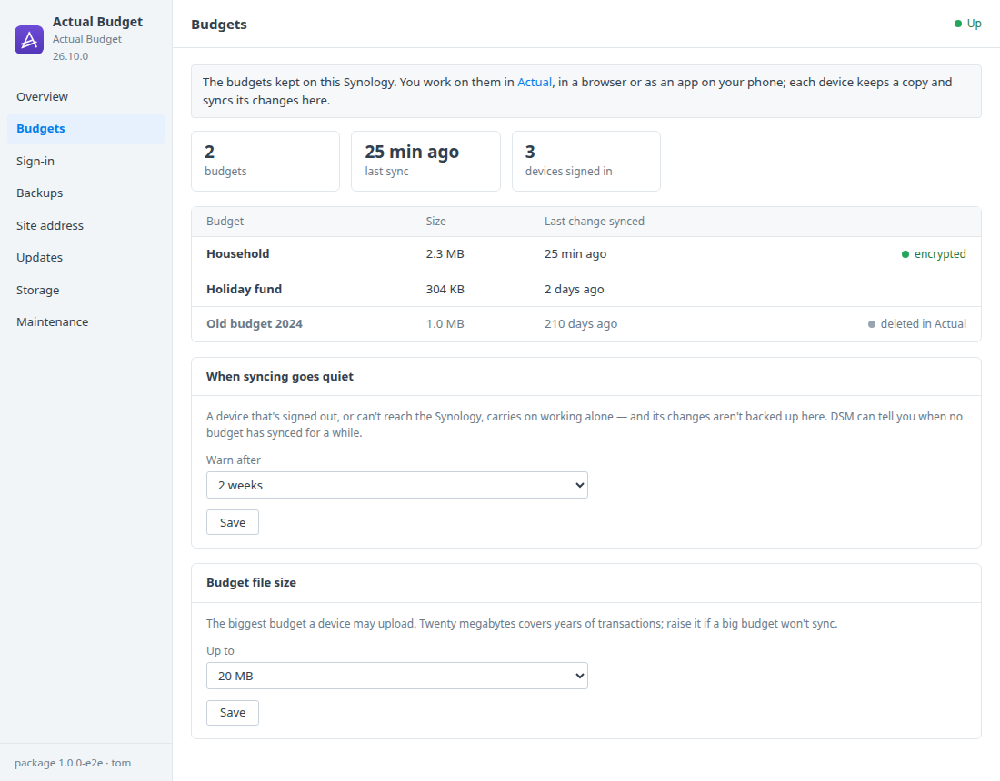
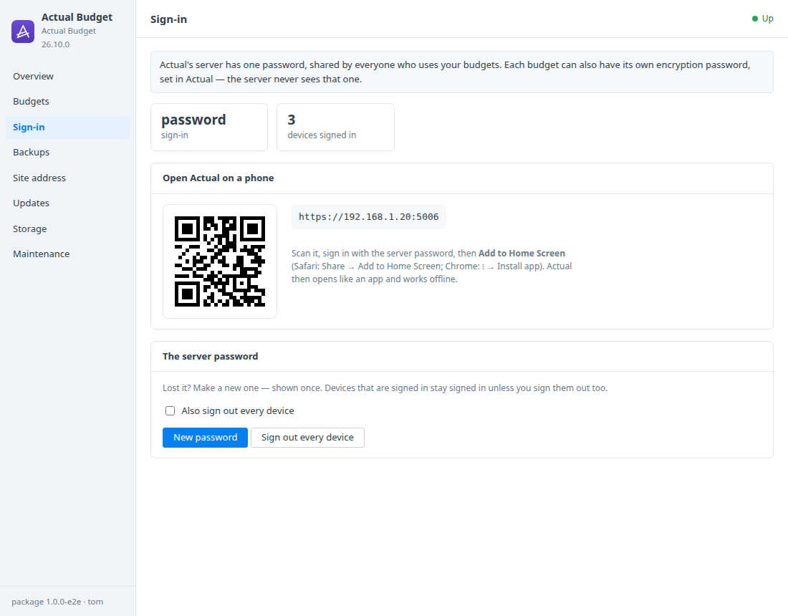

# Actual Budget for Synology DSM

A DSM 7 package that installs [Actual Budget](https://actualbudget.org)'s server
in Container Manager. Actual is private, fast envelope budgeting that syncs
between your browsers and phones, with your budgets kept on your Synology
instead of someone else's cloud. A DSM window looks after:
- the server's password;
- the devices signed in;
- a warning when syncing goes quiet;
- the HTTPS Actual needs;
- backups and updates.

Built on the [DSM app chassis](https://github.com/tombruton87/dsm-app-chassis).

## Download

### **[⬇ Download actual.spk](https://github.com/tombruton87/actual-dsm/releases/latest/download/actual.spk)**

[](https://github.com/tombruton87/actual-dsm/releases/latest)

That link always gives the newest version. Older ones are on the
[Releases](https://github.com/tombruton87/actual-dsm/releases) page.

Install: Package Center → Manual Install → the `.spk` (DSM 7.2.1+; Container
Manager is installed first if missing). The wizard asks for the NAS's address,
a port (5006 by default), a time zone and HTTPS. The server's password is made
at the first start and shown once in the window.

**HTTPS is on from the start.** Actual's web app relies on browser features
that only work on secure pages. The package serves HTTPS with DSM's own
certificate (the system default from Control Panel → Security → Certificate,
with renewals picked up daily). If there isn't one, it uses a self-signed
certificate. Plain HTTP is offered only behind DSM's reverse proxy, which then
provides the HTTPS.

## What the DSM window adds

- **Budgets**
  - Every budget on the server: size, when it last synced, and whether it's
    encrypted or deleted in Actual.
  - How many devices are signed in.
  - **When syncing goes quiet:** a DSM notification if no budget has synced
    for 3, 7, 14 or 30 days. A device that's signed out or can't reach the NAS
    keeps working alone, and its changes aren't backed up here.
  - The biggest budget file a device may upload.
- **Sign-in**
  - Open Actual on a phone from a QR code, then Add to Home Screen.
  - **New password** (shown once), optionally signing every device out.
  - **Sign out every device**.
- **Site address** — the address, and HTTPS with DSM's certificate or a
  self-signed one.
- **Backups, updates, storage, maintenance** — consistent copies of every
  budget and the server's account (each SQLite file copied with
  `sqlite3 .backup`), made nightly or on demand, with restore. You can also:
  - update to newer images or a newer package from inside DSM;
  - make a redacted support report;
  - read the logs;
  - remove Actual and everything with it.

## Screenshots

| | |
|---|---|
|  |  |

## How it works

Actual's server (`actualbudget/actual-server`) runs as one container. Budgets,
the server's account and the HTTPS certificate live in the `actual_data`
volume.

Actual has no admin API. The package works through Actual's own account
functions instead: the ones its `reset-password` script uses, found from that
script's import line, so a new build's renamed files don't matter. A short
Node script piped into the container calls them, with passwords on stdin. The
window's numbers come from Actual's SQLite files. Your password is never
stored.

## Layout

```
chassis/          the DSM app chassis (git submodule)
package.conf      name, title, services, volumes, images, port, texts
app/compose.yaml  Actual's server
setup/app.sh      the hooks: the password, the quiet-sync warning, HTTPS, backups
setup/ab.mjs      Actual's own account functions and SQLite files, for the window
ui/               Budgets and Sign-in tabs; CGI validation
wizard/           the HTTPS page of the install wizard
tests/            steps for the chassis harness (a device's budget upload, sign-ins, HTTPS)
```

Test: `chassis/tests/e2e.sh . up && chassis/tests/e2e.sh . act` on any Linux
box with Docker.

Release: bump `VERSION`, add the changes to `CHANGELOG.md`, build, then attach
the package twice, under its versioned name and as `actual.spk`:

```bash
cp dist/actual-X.Y.Z-1.spk /tmp/actual.spk
gh release create vX.Y.Z dist/actual-X.Y.Z-1.spk /tmp/actual.spk
```

Build: `chassis/build.sh . N`.

## Credits

The icon is Actual's own mark on a DSM-style tile in its purple. Actual Budget
is MIT-licensed open-source software by its contributors. This package is not
affiliated with Actual Budget or Synology.
